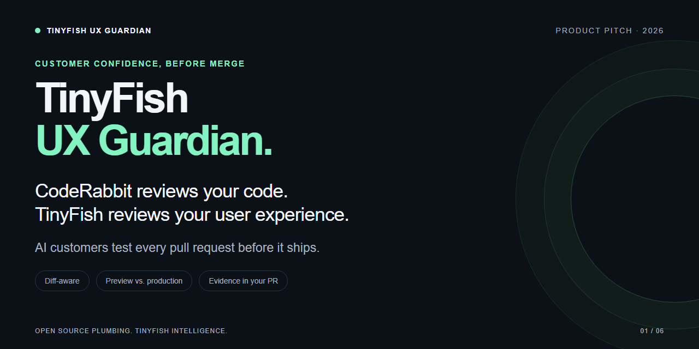
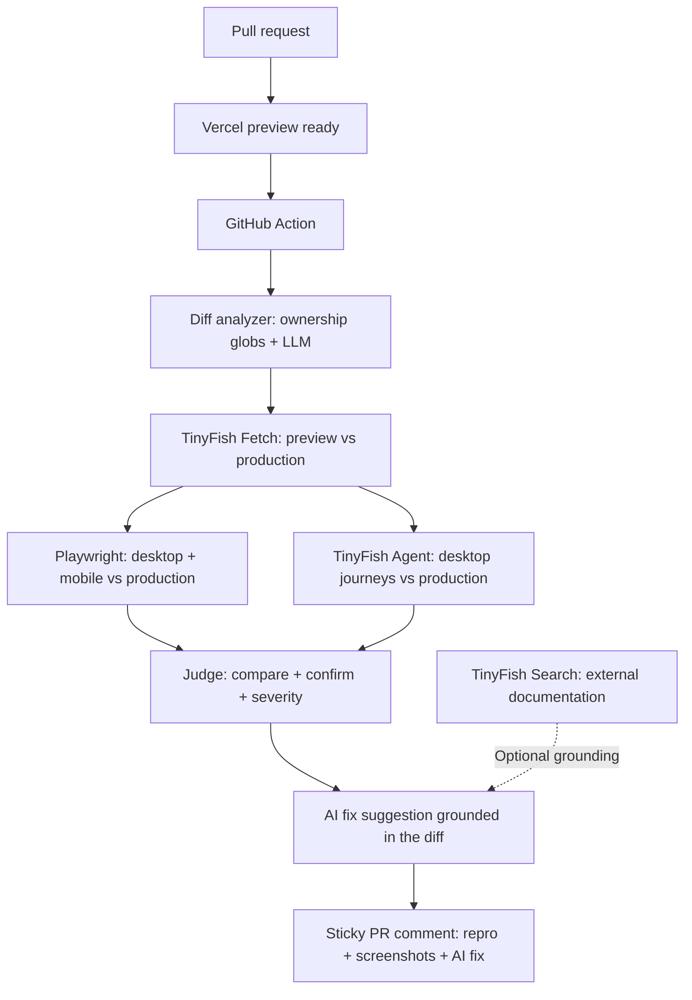

<a id="top"></a>
<div align="center">
  
  <h1>TinyFish UX Guardian</h1>
  <p><strong>CodeRabbit reviews your code. TinyFish reviews your user experience.</strong></p>
  <p>A GitHub Action that tests affected customer journeys against production and puts confirmed regressions, screenshots and AI fix suggestions in your PR.</p>
  <p>
    <a href="https://github.com/aranish-uk/ux-guardian/actions/workflows/ci.yml"></a>
    <a href="https://www.python.org/downloads/release/python-3120/"></a>
    <a href="NOTICE"></a>
    <a href="https://www.tinyfish.ai/"></a>
    <a href="https://github.com/browser-use/vibetest-use"></a>
  </p>
  <p>
    <a href="#results-from-the-live-demo">Demo PRs</a> ·
    <a href="https://ux-guardian-demo.vercel.app">Live demo store</a> ·
    <a href="pitch/UX-Guardian-pitch.pdf">Pitch deck</a> ·
    <a href="#how-it-works">How it works</a>
  </p>
</div>

## See it catch a real bug

<table>
  <tr><th>Preview · blocked</th><th>Production · works</th></tr>
  <tr>
    <td></td>
    <td></td>
  </tr>
</table>

**P1 — sign-in button blocked on mobile, caught before merge.** [Read the finding →](https://github.com/aranish-uk/ux-guardian/pull/1#issuecomment-6114005313)

All six TinyFish desktop journeys passed. Playwright's mobile actionability check caught the overlay intercepting taps; the same control worked on production.

## Why

- A correct-looking diff can still leave customers unable to sign in or check out.
- Scripted E2E tests cover the flows someone anticipated; UI changes demand maintenance.
- A failing preview alone cannot tell you whether the PR introduced the problem. You need a production baseline.

## How it works



Checks and Agent journeys run in parallel. The judge compares equivalent signals on the same viewport; screenshots support the verdict rather than decide it.

| TinyFish product | Job in Guardian |
| --- | --- |
| **Agent** | Acts as a customer through selected journeys on preview and production; returns structured outcomes and step evidence. Desktop only. |
| **Fetch** | Free rendered-page pre-check of entry URLs; feeds status and text evidence to the judge before Agent spend. |
| **Search** | Optionally grounds fix suggestions in external framework docs or known issues. Skipped when the diff makes the cause obvious. |

## Results from the live demo

| PR | Observed result | Run evidence |
| --- | --- | --- |
| [#1 · Mobile sign-in](https://github.com/aranish-uk/ux-guardian/pull/1) | **P1:** button covered on mobile; production passes | 6 desktop Agent journeys, **$1.18** TinyFish cost; mobile caught by Playwright |
| [#2 · Broken cart route](https://github.com/aranish-uk/ux-guardian/pull/2) | **P0:** `/cart` returns 404; production passes | AI patch in the comment, checked with `git apply --check`; no paid Agent runs |
| [#3 · Harmless copy change](https://github.com/aranish-uk/ux-guardian/pull/3) | **0 findings:** no customer-facing journeys affected | Fully automatic preview trigger; **about 40s** for the workflow (45s recorded), 3.48s analysis/report |

These are individual demo runs, not a benchmark or a five-run reliability claim. The [automatic clean run](https://github.com/aranish-uk/ux-guardian/actions/runs/38178831107) shows the deployment trigger; suggested patches still need developer review. TinyFish cost excludes LLM and CI costs.

## 🚀 Quickstart

**Python 3.12 + [uv](https://docs.astral.sh/uv/) required.** Start with a local fixture replay:

```text
git clone https://github.com/aranish-uk/ux-guardian.git
cd ux-guardian
uv sync
uv run ux-guardian run --preview-url https://preview.example.invalid --pr 1 --dry-run
```

This writes `artifacts/report.json` and `artifacts/report.md` from recorded evidence. It never contacts the supplied URL and needs no secrets or paid calls.

To bring the integration into your repo:

1. Copy [`.github/workflows/ux-guardian.yml`](.github/workflows/ux-guardian.yml) and [`.ux-guardian/`](.ux-guardian/) into the same locations. The workflow also needs the Guardian Python package and uv project: copy [`ux_guardian/`](ux_guardian/), [`pyproject.toml`](pyproject.toml), [`uv.lock`](uv.lock) and [`NOTICE`](NOTICE) into a compatible repository scaffold. Copying only the YAML is insufficient.
2. Add repository **Actions secrets**: `TINYFISH_API_KEY`, `LLM_API_KEY`, `TEST_EMAIL`, `TEST_PASSWORD`. GitHub supplies `GITHUB_TOKEN`. Use a seeded test account; keep credentials out of journeys and screenshots.
3. Connect the demo app to Vercel's GitHub integration with Root Directory `demo-app`. Put the same test-account secrets in Vercel's Preview and Production environments. Successful **Preview** deployment statuses trigger the workflow once it is on the default branch; previews must be reachable by the checks.
4. Review [`.ux-guardian/config.yaml`](.ux-guardian/config.yaml): production baseline, concurrency, budget and `fail_on`. Define journeys in [`.ux-guardian/journeys.yaml`](.ux-guardian/journeys.yaml), starting with this real sign-in example:

```yaml
journeys:
  - id: sign-in
    name: Sign in with test account
    entry_path: /login
    goal: >
      You are a returning customer. Sign in with email {{TEST_EMAIL}} and password
      {{TEST_PASSWORD}}. Confirm you land on your account dashboard.
    success_criteria: ['Dashboard heading containing "Your account" is visible']
    owns: ['app/(auth)/**', 'app/login/**', 'app/account/**', 'app/api/login/**', 'lib/session.ts', 'components/auth/**', 'middleware.ts']
    critical_selectors: ['button[type=submit]']
    viewports: [desktop, mobile]
    max_steps: 25
```

**MVP boundary:** live CI currently validates this demo's Vercel preview hostnames. The steps above explain the integration scaffold; using an unrelated app requires a reviewed code adaptation and is outside the shipped demo scope. Fixture replay works anywhere.

For local browser checks, install Chromium with `uv run playwright install chromium`. Manual workflow dispatch defaults paid Agents off; the automatic preview trigger enables desktop Agent pairs with an effective $2 cap. Default config budget is $3. A paid local run via `uv run ux-guardian live journey --journey sign-in --env prod` prints an estimate and asks for confirmation.

<details>
<summary><strong>How we decide it's a real regression</strong></summary>

| Preview | Production | Verdict |
| --- | --- | --- |
| Fail | Pass | Confirmed with a matching hard deterministic signal; otherwise a candidate |
| Fail | Fail | Pre-existing issue; not attributed to the PR |
| Pass | Pass | OK |
| Pass | Fail | Possible improvement |

Hard signals include an origin 4xx/5xx or a critical control that is missing, hidden, disabled or covered. Compare the same control and viewport against production. Transport timeouts, pixel differences and Fetch text warnings alone are inconclusive.

Agent-only candidates require a confirming preview retry at the same or earlier step, or matching deterministic proof with a passing production baseline. The current CI runner defers paid retries, so unsupported Agent-only failures remain unconfirmed and do not fail the check.

| Severity | Short rule | Demo example |
| --- | --- | --- |
| **P0** | Origin HTTP error or journey blocked on every viewport | Cart 404 |
| **P1** | Journey blocked on one viewport or needs a non-obvious workaround | Mobile sign-in overlay |
| **P2** | Journey completes with degraded UX | Extra step or misleading message |

Rules assign severity first; the LLM may lower it with justification, never raise it. Default `fail_on: [P0]` fails CI only on confirmed P0 findings. See [PRD FR7–FR8](PRD.md) and [judge tests](tests/test_m2.py).

</details>

<details>
<summary><strong>Compared to…</strong></summary>

This compares typical setups, not universal limits: you can build these features around any testing tool.

| Approach | Diff-aware journeys | Production baseline | Evidence in the PR | AI fix |
| --- | --- | --- | --- | --- |
| Plain E2E suites | Usually scripted selection | Needs custom wiring | CI result; richer reports need wiring | Usually manual |
| AI code reviewers | Code diff | Usually no browser baseline | Code review comments | Code suggestions |
| Local AI QA swarms | Often page/task driven | Needs custom wiring | Needs CI integration | Tool-dependent |
| **UX Guardian demo** | Ownership globs + LLM | Preview vs prod | Sticky comment + screenshots | Diff-grounded patch suggestion |

The three linked PRs demonstrate Guardian's row; they do not establish superiority over other tools.

</details>

<details>
<summary><strong>Honest limitations</strong></summary>

- **No Agent viewport control.** TinyFish Agent runs at its default desktop viewport. All mobile coverage comes from Playwright.
- **Default concurrency is 2.** Agent runs queue; six journeys do not start simultaneously.
- **Screenshot URL path workaround.** Returned Agent URLs omitted `/v1` and returned 401. The adapter corrects the Agent-host path before download. Some step images can still be unavailable.
- **Cost is about $0.016 per Agent step.** Journey length changes spend; LLM and CI costs are separate. Budget caps can leave partial coverage.
- **One controlled demo, three journeys.** No arbitrary-site rollout, fork PR runs, real payments, security audit or pixel-perfect design review. Every Agent goal includes “Never submit payment, never send messages, never delete data.”
- **Evidence hosting differs by run.** The showcased PR #1 uses public raw assets; the shipped workflow uploads Actions artifacts. Agent-only retries and the `/ux-guardian rerun` command remain deferred.

Verified implementation status lives in [PROGRESS.md](PROGRESS.md); the scope lives in [PRD.md](PRD.md).

</details>

<details>
<summary><strong>Roadmap</strong></summary>

- [x] TinyFish desktop Agent adapter with queue, budget guard and screenshot downloads.
- [x] Playwright desktop/mobile checks, Fetch pre-check and production comparison.
- [x] Diff selection, sticky PR reports, AI fix suggestions and automatic Vercel preview trigger.
- [ ] Complete M6: five runs of each demo PR and a recorded demo video.
- [ ] Confirm Agent-only candidates with paid retries; finish public evidence hosting.
- [ ] Post-MVP: GitHub App, discovered journeys, persona swarms and production monitoring.

Future items are plans, not shipped features. See [milestones and long-term vision](PRD.md).

</details>

<details>
<summary><strong>Built with</strong></summary>

[Python 3.12](https://www.python.org/) · [uv](https://docs.astral.sh/uv/) · [TinyFish](https://www.tinyfish.ai/) · [Playwright](https://playwright.dev/python/) · [GitHub Actions](https://github.com/features/actions) · [Vercel](https://vercel.com/)

Pydantic validates contracts; a provider seam isolates the LLM; Pillow + pixelmatch produce visual evidence. The demo store uses Next.js. Vendor SDK imports stay behind the TinyFish adapter; fixtures let the judge and report run offline.

Development checks (Windows and Linux):

```text
uv run pytest
uv run ruff check .
uv run pyright
```

For a guided presentation, use [the three-minute demo script](docs/DEMO.md) or [the HTML pitch](pitch/index.html).

</details>

<details>
<summary><strong>Credits & upstream license</strong></summary>

Based on [browser-use/vibetest-use](https://github.com/browser-use/vibetest-use), at commit `fe0b90ac9d6a129ce06f5b53074241a9f205015b`, with original history preserved. Its bounded asyncio swarm and optional MCP interface form the foundation; browser-use was replaced by TinyFish.

**Upstream declares MIT in its README and has no LICENSE file.** The license badge refers to that upstream declaration. Attribution is retained in [NOTICE](NOTICE).

Thanks to [TinyFish](https://www.tinyfish.ai/) for customer-journey intelligence and [Playwright](https://playwright.dev/python/) for deterministic browser evidence. README presentation follows patterns collected in [awesome-readme](https://github.com/matiassingers/awesome-readme) and [Best-README-Template](https://github.com/othneildrew/Best-README-Template).

Reference-only repositories in the PRD supplied ideas; no code was copied from them.

</details>

---

<p align="center">Open source plumbing. TinyFish intelligence.<br><a href="#top">Back to top ↑</a> · <a href="https://github.com/aranish-uk/ux-guardian/issues">Issues</a> · <a href="docs/DEMO.md">Demo walkthrough</a></p>
