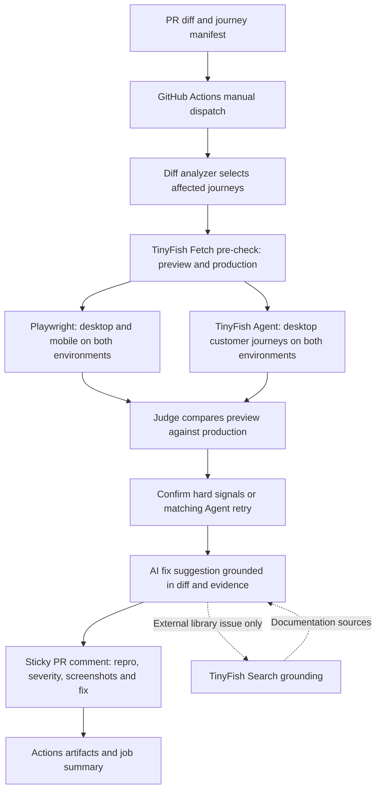

# TinyFish UX Guardian: three-minute demo

Before presenting, open the three PRs and their existing Guardian comments, the
[demo store](https://ux-guardian-demo.vercel.app), and the screenshot artifacts.
Use the saved results for the timed walkthrough. This script documents a later
workflow dispatch; no live run is needed during the presentation.

## 0:00–0:20 — Pitch

“CodeRabbit reviews your code. TinyFish reviews your user experience. We test the
customer journeys a PR could break, compare its preview against production, and
leave one comment with evidence and a suggested fix.” Show the storefront.

## 0:20–0:45 — Clean PR first

Open [PR #3: harmless copy change](https://github.com/aranish-uk/ux-guardian/pull/3).
Show the clean verdict and **0 findings**. “A changed page is not automatically a
bug. Production comparison and confirmation keep the report useful.”

## 0:45–1:25 — P0 broken cart route and AI fix

Open [PR #2](https://github.com/aranish-uk/ux-guardian/pull/2). Expand the P0 finding.
Show the repro steps, preview route failure, passing production baseline and
screenshots. “A broken cart route prevents checkout. An origin 404 is a hard
signal, so the judge can confirm it without an Agent retry.”

Show the AI fix suggestion in the prepared demo comment and compare it with the
changed route. “The suggestion connects the evidence to the diff. A developer
reviews it before applying it.” If the displayed comment predates M5 enrichment,
use the prepared fix example: restore the working cart route from the base diff;
label that example as a hypothesis rather than a generated patch. This M4 docs
branch does not add fix-generation code.

## 1:25–2:05 — P1 mobile-only sign-in

Open [PR #1](https://github.com/aranish-uk/ux-guardian/pull/1). Show desktop passing
and mobile failing on preview, with mobile passing on production. Open the
Playwright preview and production mobile screenshots from the report's artifact
link. Point out the overlay covering the sign-in button and the actionability
signal. “One viewport is blocked, so this is P1. TinyFish Agent has no viewport
control; Playwright supplies the mobile evidence and independently confirms it.”

## 2:05–2:35 — How to trigger a run

Show this command without executing it during the timed demo. Replace the URL
with PR #2's existing demo Vercel preview URL; use the trusted workflow/code ref
that contains the deployed Guardian implementation.

```text
gh workflow run ux-guardian.yml --repo aranish-uk/ux-guardian --ref main -f pr_number=2 -f preview_url="<PR_2_VERCEL_PREVIEW_URL>" -f base_ref=main -f agent_runs=false
```

“The manual workflow analyzes the diff, runs Fetch and Playwright against preview
and production, then updates one sticky comment and uploads the evidence.”
`agent_runs=false` disables paid desktop Agent runs; Fetch and configured LLM
analysis can still call their APIs. A later run with `agent_runs=true` explicitly
opts into paid desktop journey pairs and the displayed estimate, capped at $2 by
the M4 workflow. Never use a site outside the controlled demo deployments.

## 2:35–3:00 — Vision

“Today this is a GitHub Action for one demo store and three journeys. The vision
is a GitHub App that discovers journeys, tests more customer personas, and runs
the same journeys in production monitoring. Every confirmed regression could
also become a lasting Playwright test.” These are future ideas, outside the MVP.

## Architecture



The diagram describes the target MVP pipeline. On the M4 base, Agent runs are
optional, paid confirmation retries and M5 fix/Search enrichment are deferred,
and screenshots use Actions artifact links. Default Agent concurrency is 2.
Agent screenshots work around the returned URL's missing `/v1` path; unavailable
images do not determine the verdict. Playwright owns all mobile coverage.
